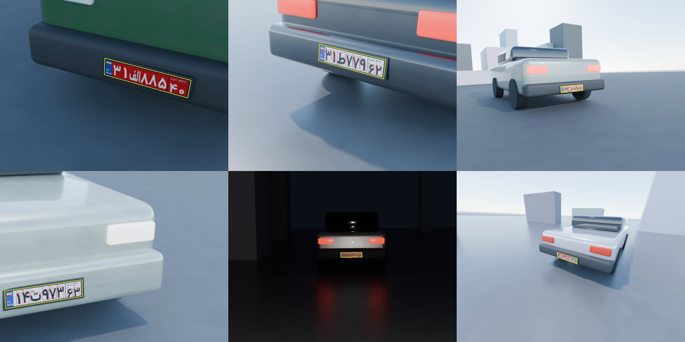

# Synthetic plates rendered in Blender

`scripts/blender_synth.py` renders cars with Iranian plates in 3D and labels them automatically. The
plate and every character are real geometry in the scene, so the boxes come from projecting that
geometry through the camera. Nothing is drawn by hand.



## What each image randomises

- **Car:** size, paint colour and gloss, dirt, plastic or painted bumper, tail lights or headlights, lamps on or off.
- **Plate:**
  - Any of the 12 templates in `Templates/`.
  - The 8 symbols are extruded 0.8 mm, like pressed metal plates.
  - Dirt, dents, reflective film, a few degrees of tilt, and a black holder.
- **Camera:**
  - Distance 1.8–10 m, up to 40° to the side and 35° from above, a few degrees of roll.
  - The plate fills 7–50% of the image width and is not always centred.
  - Sometimes depth of field.
  - The camera is re-rolled until the whole plate is in frame. Any wall between the camera and the plate is removed.
- **Light:**
  - Day: a physical sky with or without hard sun.
  - Night (25%): a headlight-like spot and sometimes a plate lamp.
  - The ground is sometimes wet.
- **After rendering:** the same blur, noise, glare, night and JPEG damage as `plpr/synth.py`.

## Run it

```bash
python scripts/blender_synth.py --n 2000 --out data/blender --preview 20
```

Blender 4.2 or newer is needed (tested with 5.2). The script looks for it in `/Applications/Blender.app`, then on `PATH`. Pass `--blender` or set `$BLENDER` to use another copy.

Output:

| Path | What |
|---|---|
| `data/blender/renders/*.jpg`, `labels.jsonl` | Clean renders. Each line has the key, plate type, plate box, the 4 plate corners and the 8 character boxes |
| `data/blender/plates/` | YOLO dataset for the plate detector: whole frames, 1 class |
| `data/blender/chars/` | YOLO dataset for the character model: loose plate crops, 43 classes |
| `data/blender/preview/` | The first N renders with their boxes drawn, for checking |

- **Splits:** every tenth image goes to `val`.
- **Resuming:** run the same command with a larger `--n` and only the new images render.
- **New noise:** `--post-only` rebuilds `plates/` and `chars/` from the existing renders with fresh noise.
- **Training:** train on them like the other synthetic sets; see [training.md](training.md).

### Speed and disk use

On an M4 MacBook (10-core GPU), Cycles at 32 samples takes about 12–15 s per 1280×960 image. The first run is slower, because Metal compiles its kernels.

| Option | Effect |
|---|---|
| `--engine eevee` | About 3× faster, with flatter lighting |
| `--samples 16` | Fewer samples. The denoiser keeps these clean |
| `--res 960 720` | Smaller images |

Disk use is about 150 KB per render, plus about the same again for `plates/` and `chars/`.

## Glyphs from real plates (instead of a font)

Vazirmatn is only close to the plate typeface. `scripts/glyphs.py` builds each symbol from real plate photos instead.

1. **`grids`** puts real crops of one character into grids of 24 (6 × 4), 3 grids per character by default. Its input is a folder with one sub-folder of crops per class. [IRANIS](https://github.com/alitourani/Iranis-dataset) (83,844 crops, on Kaggle and data.world) uses this layout and the same class names as `plpr/labels.py`.
2. **`redraw`** sends each character's grids to Gemini image generation (Nano Banana). It asks for that one character, drawn clean in the plate typeface, black on white. The model is chosen with `--model`; pass the Nano Banana Pro model id to use Pro. Needs `GEMINI_API_KEY`.
3. **`trace`** turns each clean image into outline and hole polygons. It also writes `sheet.png`, so you can check every glyph at a glance.

```bash
python scripts/glyphs.py grids  --src /path/to/iranis --out data/glyphs
GEMINI_API_KEY=... python scripts/glyphs.py redraw --out data/glyphs --model <nano-banana-pro-id>
python scripts/glyphs.py trace  --out data/glyphs
python scripts/blender_synth.py --n 2000 --out data/blender --glyphs data/glyphs/shapes
```

- **Checking the redraws:** look at `data/glyphs/raw/*.png` before tracing. To retry a bad glyph, run `redraw --only <code>`.
- **Missing classes:** IRANIS has 28 classes. The other plate letters (ز ش ک and so on) fall back to the font, and the script lists them.
- **Glyph size:** a traced glyph has no size of its own. Its height relative to a digit comes from the font (for example, ۰ is small), and it is centred on the digit band.

## Limits

- **Car shapes:** the car is a few rounded boxes. Plate detection does not depend on the car's shape, but the backgrounds are simpler than real streets. Importing real car models would help.
- **Plates per image:** one plate per image, never occluded, and never cut by the image edge.
- **Labels:** character boxes are tight around the visible 3D glyph, including its extruded sides. Hand-labelled boxes on real plates may be slightly looser.
- **Current model:** the v1 model found all 12 plates in a 12-image test render. It read 4 of them exactly; most misses were letters and ۰. This is the gap retraining on these images should close.
